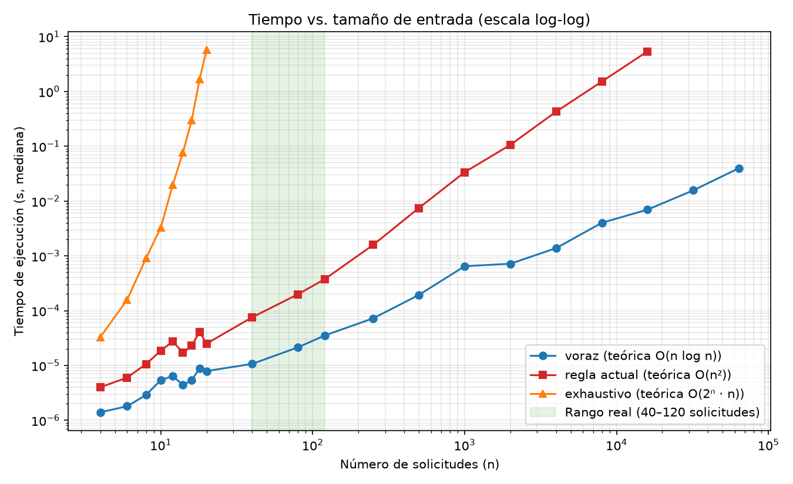
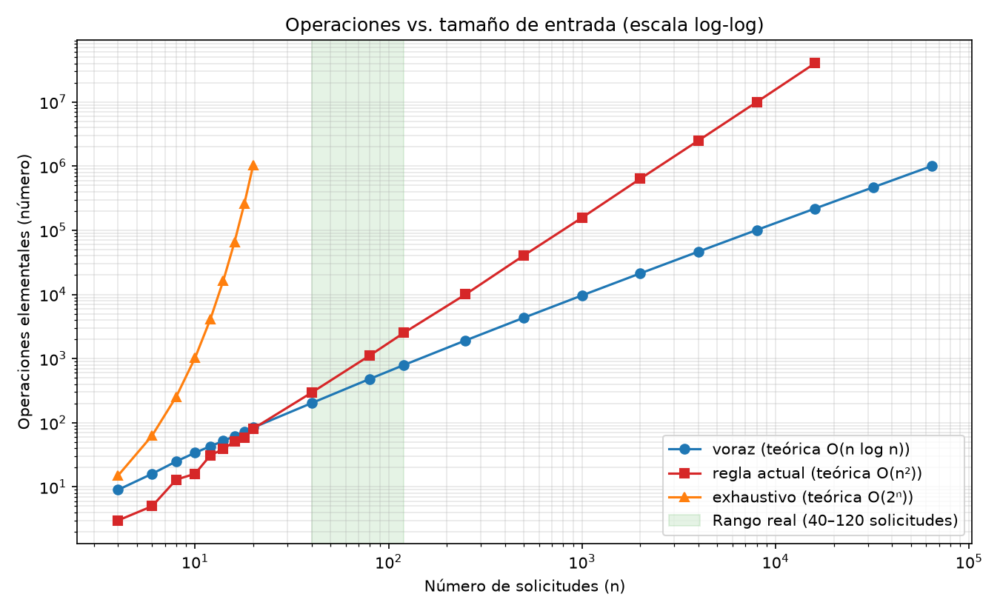
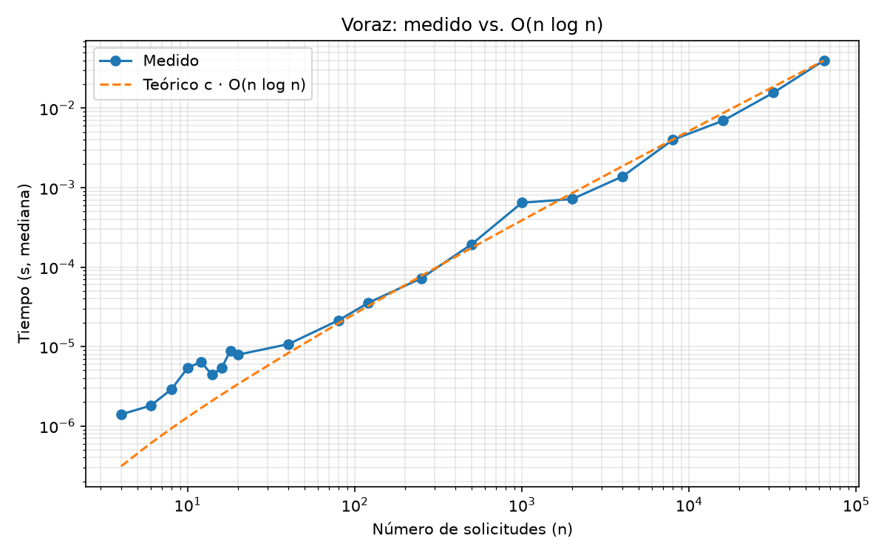
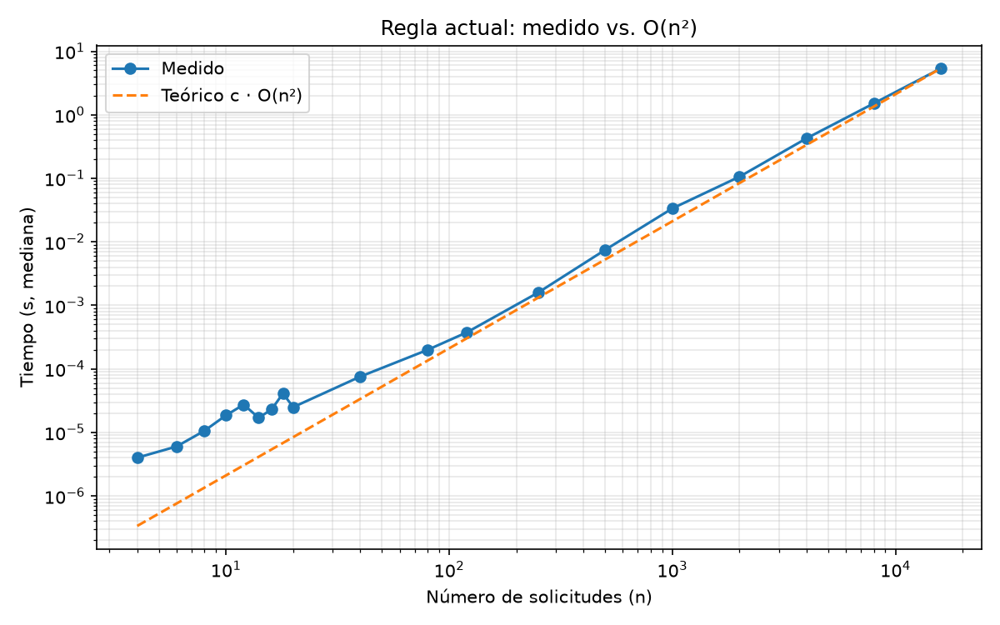
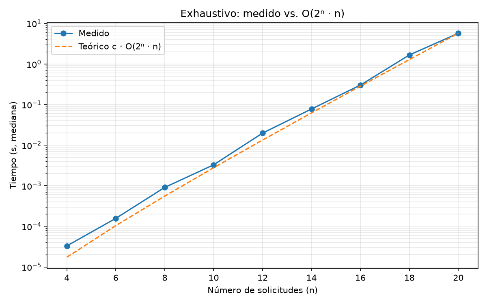

### Laboratorio #4: Programación dinámica y algoritmos voraces
# 1. Presentación
## Caso #2: Plataforma Pulso - programación de las jornadas de las unidades móviles

### Integrantes:
- Juliana Arroyave Arango
- Juliana Gómez Legarda
- Juan Pablo Gómez
- Felipe Londoño García

Grupo: 190304006-3

Profesor: Santiago Suárez Cortés

# 2. Análisis del problema
## Descripción general del problema
La Secretaría de Salud cuenta con nueve unidades móviles de valoración, una asignada a cada subregión del departamento. Mensualmente, los municipios presentan solicitudes para realizar jornadas de atención, indicando la fecha y hora de inicio, la fecha y hora de finalización (incluyendo el tiempo de desplazamiento) y la cantidad de pacientes de alto riesgo que tienen pendientes de atención.

El problema surge porque cada unidad móvil solamente puede atender una jornada a la vez. Por lo tanto, cuando dos o más solicitudes presentan horarios superpuestos, es necesario decidir cuáles serán aceptadas y cuáles deberán rechazarse.

Actualmente, el coordinador realiza esta asignación siguiendo el orden de llegada de las solicitudes. Este procedimiento acepta una jornada cuando no presenta conflictos con las jornadas previamente programadas. Sin embargo, esta estrategia no garantiza que se obtenga la mayor cantidad posible de jornadas durante el mes, puesto que una solicitud aceptada inicialmente puede impedir la programación de varias jornadas posteriores.

Para resolver el problema, se propone implementar un algoritmo voraz que seleccione las jornadas según su hora de finalización, priorizando aquellas que terminan más temprano. Después de seleccionar una jornada, el algoritmo evalúa las solicitudes restantes y acepta únicamente aquellas cuyo horario de inicio sea mayor o igual a la hora de finalización de la última jornada seleccionada. El algoritmo se ejecutará independientemente para cada subregión, debido a que cada una dispone de su propia unidad móvil.

Es importante aclarar que el criterio de optimización elegido es **maximizar el número de jornadas**, no maximizar la cantidad de pacientes de alto riesgo atendidos. Por esta razón, el número de pacientes pendientes se conserva como información de cada solicitud, pero no interviene en la decisión de selección.
## Entradas, salidas, restricciones y supuestos de la operación
### Entradas
- Entre 40 y 120 solicitudes mensuales por subregión.
- Fecha y hora de inicio de cada jornada.
- Fecha y hora de finalización de cada jornada, incluido el desplazamiento.
- Cantidad de pacientes de alto riesgo pendientes por municipio.
- Identificación del municipio y de la subregión.
### Salidas
- Lista de jornadas seleccionadas.
- Cantidad total de jornadas programadas.
- Información de identificación, horario y municipio de cada jornada seleccionada.
### Restricciones
- Cada subregión cuenta con una única unidad móvil.
- No puede existir ninguna superposición de horarios para una misma unidad.
- El tiempo de desplazamiento se incluye dentro de la duración de cada jornada.
- Maximización de la cantidad de jornadas.
- Ejecución secuencial en un servidor de aproximadamente 380 W.
### Supuestos de la operación
- Una solicitud puede iniciar inmediatamente después de la hora de finalización de la solicitud anterior (es decir, el intervalo se entiende como `[inicio, finalización)`)
- Todos los datos ingresados son válidos y consistentes.
- Los datos son inmutables durante la ejecución.
- La solución no incluye una interfaz gráfica.
- Ausencia de persistencia en bases de datos.
- Carga completa de datos en memoria.
- Utilización de conjuntos de datos sintéticos de tamaño creciente.
- Ejecución en un único hilo y servidor.
# 3. Diseño de la solución
## ¿Por qué el problema admite la estrategia elegida?
La Operación 3 de la plataforma Pulso admite una estrategia voraz porque corresponde al problema clásico de selección de actividades, cuyo objetivo es seleccionar el mayor número posible de intervalos compatibles entre sí.

En este caso, cada actividad representa una solicitud de jornada de valoración de una unidad móvil. Cada solicitud tiene una hora de inicio y una hora de finalización. La estrategia elegida consiste en seleccionar siempre la jornada que termina más temprano entre las solicitudes disponibles, ya que esta decisión permite liberar la unidad móvil lo antes posible y dejar la mayor cantidad de tiempo disponible para programar otras jornadas.
## Ejemplo práctico resuelto paso a paso:
Para representar el funcionamiento del algoritmo, supongamos que una unidad móvil de valoración de una subregión recibe las siguientes seis solicitudes de jornadas durante el mes:
| Jornada | Hora de inicio | Hora de finalización |
| ------- | -------------- | -------------------- |
| 1       | 08:00          | 10:00                |
| 2       | 09:00          | 11:00                |
| 3       | 10:00          | 12:00                |
| 4       | 11:00          | 13:00                |
| 5       | 12:00          | 14:00                |
| 6       | 13:00          | 15:00                |

### Paso 1: Ordenar las solicitudes por hora de finalización
En este ejemplo, las solicitudes ya se encuentran ordenadas de menor a mayor hora de finalización:

`[1, 2, 3, 4, 5, 6]`
### Paso 2: Seleccionar la primera actividad
Se selecciona la primera actividad del paso anterior, es decir, la que tiene menor hora de finalización:

`Jornada 1 (08:00 - 10:00)`
### Paso 3: Evaluar la siguiente jornada (jornada 2)
Se evalúa la siguiente jornada por orden de hora de finalización, es decir, la jornada 2:

`Jornada 2 (09:00 - 11:00)`

Como se traslapa su hora de inicio con la hora de finalización de la jornada 1, entonces la jornada 2 es **rechazada**.
### Paso 4: Evaluar la jornada 3
Se evalúa la siguiente jornada por orden de hora de finalización, es decir, la jornada 3:

`Jornada 3 (10:00 - 12:00)`

Como **NO** se traslapa su hora de inicio con la hora de finalización de la jornada 1, entonces la jornada 3 es **aceptada**.
### Paso 5: Evaluar la jornada 4
Se evalúa la jornada 4:

`Jornada 4 (11:00 - 13:00)`

Como se traslapa su hora de inicio con la hora de finalización de la jornada 3, entonces la jornada 4 es **rechazada**.
### Paso 6: Evaluar la jornada 5
Se evalúa la jornada 5:

`Jornada 5 (12:00 - 14:00)`

Como **NO** se traslapa su hora de inicio con la hora de finalización de la jornada 3, entonces la jornada 5 es **aceptada**.
### Paso 7: Evaluar la jornada 6
Se evalúa la jornada 6:

`Jornada 6 (13:00 - 15:00)`

Como se traslapa su hora de inicio con la hora de finalización de la jornada 5, entonces la jornada 6 es **rechazada**.
### Paso 8: Condensación de la solución
Se consolidan las jornadas aceptadas en un único listado, se excluyen entonces las jornadas rechazadas del arreglo original. De esta manera queda entonces la siguiente lista de solicitudes ordenada por hora de finalización:

`Jornadas [1, 3, 5]`

El total de solicitudes aceptadas para el mes es de **3**.

# 4. Implementación

## Descripción de la solución desarrollada

El código se encuentra en `src/jornadas_unidades/`. Cada archivo tiene una función específica dentro del desarrollo del proyecto:

- [estrategia.py](src/jornadas_unidades/estrategia.py): contiene la estrategia voraz (`seleccionar_jornadas`) y las funciones de apoyo `hay_cruce` y `valor`.
- [exhaustivo.py](src/jornadas_unidades/exhaustivo.py): contiene una solución que prueba todas las combinaciones posibles de solicitudes (2ⁿ). Se utiliza como referencia para comprobar si los resultados son óptimos en casos pequeños.
- [regla_actual.py](src/jornadas_unidades/regla_actual.py): representa la forma en que el coordinador realiza actualmente la asignación, teniendo en cuenta el orden de llegada de las solicitudes y rechazando aquellas que se cruzan.
- [datos.py](src/jornadas_unidades/datos.py): genera ejemplos de solicitudes de manera automática, utilizando una semilla fija para obtener los mismos datos en cada ejecución.
- [medicion.py](src/jornadas_unidades/medicion.py): compara el tiempo y la cantidad de operaciones de las tres soluciones con diferentes cantidades de solicitudes. También guarda los resultados en archivos CSV y genera las gráficas.
- [pruebas.py](src/jornadas_unidades/pruebas.py): contiene pruebas con `assert` para comprobar que las tres soluciones funcionen correctamente.

## Tecnologías y herramientas utilizadas

- Python 3.12.5, utilizando anotaciones de tipo y docstrings para facilitar la comprensión del código.
- Biblioteca estándar: `csv`, `gc`, `math`, `random`, `statistics`, `time`, `functools`, `pathlib` y `typing`.
- Librerías externas: `matplotlib` para crear las gráficas y `numpy` para calcular el exponente empírico a partir de los resultados. Las versiones exactas están en `requirements.txt`.
- GitHub para trabajar en equipo y llevar un registro de los cambios realizados en el proyecto.

## Decisiones de implementación relevantes

- **Jornadas que se tocan en un extremo.** Se estableció que una jornada puede comenzar justo cuando termina otra, sin que esto se considere un cruce. Para manejar esta situación, los intervalos se representan como `[inicio, fin)`. Por esta razón, la estrategia voraz utiliza `>=` y la función `hay_cruce` utiliza `>` para identificar los cruces. La regla actual también sigue esta misma condición, de manera que las tres soluciones trabajen bajo las mismas reglas.

- **Ordenamiento estable y empates.** Cuando dos solicitudes terminan a la misma hora, Python mantiene el orden en el que fueron recibidas. De esta forma, se selecciona primero la que llegó antes. Esto no afecta la cantidad de jornadas que se pueden asignar, ya que ambas solicitudes liberan la unidad al mismo tiempo, pero permite obtener resultados consistentes en cada ejecución.

- **Tres soluciones escritas a mano.** Se decidió desarrollar las tres soluciones sin utilizar librerías especializadas en intervalos u optimización. Así es posible entender cómo funciona cada una, revisar sus pasos y contar las operaciones que realiza, facilitando una comparación más clara entre ellas. Para ordenar las solicitudes se utiliza la función `sorted` de Python, en lugar de implementar un algoritmo de ordenamiento propio.

- **Datos sintéticos reproducibles.** La función `generar_instancia` utiliza un generador propio (`random.Random(semilla)`) para crear las solicitudes. Esto permite que, al utilizar la misma cantidad de solicitudes (`n`) y la misma semilla, se obtengan siempre los mismos datos. De esta manera, las tres soluciones trabajan con exactamente la misma información. Además, las solicitudes se entregan en el orden en que fueron generadas, que es el que necesita la regla actual.

- **Horizonte que crece con n.** El tiempo disponible para las jornadas se calcula con la fórmula `n · 180` minutos. Esto se hace porque, si el tiempo disponible fuera siempre el mismo, al aumentar la cantidad de solicitudes sería más probable que todas se cruzaran. Al aumentar también el tiempo disponible, se mantiene una proporción similar entre las solicitudes y el tiempo, lo que permite comparar mejor los resultados. Las duraciones de las jornadas van de 1 a 8 horas y los pacientes de alto riesgo se asignan aleatoriamente entre 1 y 40, aunque este dato no influye en la selección de las jornadas.

- **Contadores separados de las funciones medidas.** En `medicion.py`, las funciones `contar_voraz`, `contar_regla_actual` y `contar_exhaustivo` permiten conocer cuántas operaciones realiza cada solución. Para hacerlo, repiten la lógica de las estrategias y llevan un registro de las operaciones sin modificar las funciones originales. Esto permite medir el tiempo de ejecución de las soluciones por separado, sin que el conteo afecte los resultados. En cada prueba también se comprueba que los contadores produzcan el mismo resultado que las funciones originales.

- **Cómo se cronometra.** Para medir el tiempo de ejecución se utiliza `time.perf_counter` y se realizan varias repeticiones, tomando como resultado la mediana de los tiempos obtenidos. Esto ayuda a evitar que situaciones momentáneas del sistema alteren demasiado las mediciones. Además, se desactiva el recolector de basura durante las pruebas y no se incluye el tiempo que tarda en generarse la información.

- **Verificación dentro del experimento.** En `medicion.py` se realizan comprobaciones durante cada prueba para verificar que las jornadas seleccionadas no se crucen, que la regla actual no obtenga un resultado mejor que la estrategia voraz y que la voraz coincida con la solución exhaustiva cuando ambas se ejecutan con el mismo tamaño de solicitudes. Por el alto costo de procesamiento de esta última, solo se realizan mediciones hasta `n = 20`.

- **Qué cubren las pruebas.** En `pruebas.py` se comprueba el funcionamiento de las soluciones en diferentes situaciones: cuando no hay solicitudes, cuando solo hay una, cuando ninguna se cruza y cuando todas se cruzan. También se revisa el comportamiento de `hay_cruce` en los extremos de los intervalos `[inicio, fin)`, el ejemplo de seis jornadas presentado en la sección 3 y 30 instancias aleatorias. En estas últimas se verifica que la estrategia voraz coincida con la exhaustiva, que no existan cruces y que la regla actual no supere el resultado de la voraz. Finalmente, se incluye un contraejemplo en el que la regla actual acepta 1 jornada, mientras que la estrategia voraz permite seleccionar 4.

# 5. Evaluación del desempeño

## 5.1 Complejidad temporal y espacial

En este apartado, n representa la cantidad de solicitudes de una subregión. El espacio se refiere a la memoria adicional que necesita cada solución para funcionar, sin incluir la lista de entrada.

**Estrategia voraz (`seleccionar_jornadas`).** Esta solución tiene dos pasos principales. Primero, organiza las solicitudes según su hora de finalización utilizando `sorted`. Python utiliza Timsort para este proceso, cuyo costo es del orden de n log n comparaciones en el peor caso. Después, recorre las solicitudes una sola vez para decidir cuáles acepta. En cada vuelta compara la hora de inicio de la solicitud actual con la hora de finalización de la última jornada aceptada (`elegidas[-1]`) y, si cumple la condición, la agrega con `append`. Como este recorrido tiene un costo constante por solicitud, su costo total es Θ(n). Por lo tanto, el ordenamiento es el paso que más tiempo consume y la complejidad temporal es Θ(n log n).

El tiempo también depende de cómo llegan organizadas las solicitudes. Si ya están ordenadas por hora de finalización, Timsort reconoce ese orden y el costo total baja a Θ(n). Si llegan en un orden diferente, se mantiene en Θ(n log n). En cuanto al espacio, `sorted` crea una nueva lista con n elementos y `elegidas` puede almacenar hasta n jornadas, por lo que la complejidad espacial es Θ(n).

**Regla actual (`asignar_por_llegada`).** Esta solución conserva el orden de llegada de las solicitudes y compara cada una con las jornadas que ya fueron aceptadas. Si en ese momento hay a jornadas aceptadas, puede realizar hasta a comparaciones, y a nunca supera el total de jornadas aceptadas (k). Por eso, el número máximo de comparaciones está limitado por n·k.

En el peor caso, ninguna solicitud se cruza con otra y todas son aceptadas. Esto significa que cada nueva solicitud debe compararse con todas las anteriores. El total de comparaciones sería 0 + 1 + … + (n−1) = n(n−1)/2, lo que corresponde a Θ(n²).

En el mejor caso, todas las solicitudes se cruzan con la primera jornada aceptada. En esta situación, cada una se rechaza desde la primera comparación y el costo es Θ(n).

En nuestras pruebas, aproximadamente el 39 % de las solicitudes son aceptadas (6 221 de 16 000 cuando n = 16 000). Esta proporción se mantiene al cambiar el tamaño de las instancias, porque el generador conserva la densidad de cruces (sección 4); con datos reales podría ser distinta. Por lo tanto, k crece proporcionalmente a n y el costo se mantiene en Θ(n²).

Esto también se refleja en las mediciones, donde las operaciones realizadas equivalen aproximadamente a 0,157·n². Este valor es menor de lo que se esperaría si cada solicitud se comparara siempre con todas las jornadas aceptadas hasta ese momento, porque `all(...)` detiene las comparaciones cuando encuentra el primer cruce. Por esta razón, el crecimiento sigue siendo cuadrático, pero con una constante menor.

Al finalizar, también se ordenan las k jornadas aceptadas. Este paso tiene un costo de Θ(k log k), pero no cambia la complejidad general, que sigue siendo Θ(n²). En cuanto al espacio, `aceptadas` puede almacenar hasta n jornadas y el `sorted` final crea otra lista de k elementos. Por lo tanto, la complejidad espacial es Θ(n).

**Solución exhaustiva (`seleccionar_exhaustivo`).** Esta solución revisa todas las combinaciones posibles de solicitudes. Para hacerlo, recorre las 2ⁿ máscaras de bits, que representan los 2ⁿ subconjuntos que se pueden formar.

En cada combinación, se revisan los n bits para construir el subconjunto correspondiente mediante una comprensión de lista. Esto tiene un costo de Θ(n) por cada máscara, independientemente de cuántas solicitudes incluya.

Después se comprueba si las jornadas del subconjunto se cruzan utilizando `hay_cruce`. Esta revisión tiene un costo de O(n). Esto se debe a que el subconjunto se construye siguiendo el orden de `ordenadas`, que ya está organizado por (inicio, fin). Por eso, el `sorted` interno de `hay_cruce` recibe los datos ordenados y puede trabajar de forma lineal. Luego, también se revisan las jornadas consecutivas para identificar posibles cruces. Esta comprobación solo se realiza cuando el subconjunto supera al mejor resultado encontrado hasta ese momento.

Al revisar todas las combinaciones, la complejidad temporal total es Θ(n · 2ⁿ). Si se observa únicamente la cantidad de subconjuntos explorados, que es lo que registra el contador, el crecimiento es Θ(2ⁿ).

En cuanto al espacio, la solución no almacena todas las combinaciones al mismo tiempo. `range(1 << n)` genera los valores de forma progresiva y en cada vuelta solo se trabaja con un subconjunto, además de las listas `ordenadas` y `mejor`. Por esta razón, la complejidad espacial es Θ(n).

**Contraste.** Las diferencias entre las tres soluciones se hacen más evidentes cuando aumenta la cantidad de solicitudes. Si n se duplica, la estrategia voraz tarda un poco más del doble (el factor es 2·(1 + 1/log₂ n)), mientras que la regla actual tarda aproximadamente cuatro veces más.

La solución exhaustiva presenta un crecimiento mucho mayor. Cada vez que n aumenta en 1, la cantidad de combinaciones que debe revisar se duplica. Si n se duplica, pasando de n a 2n, el número de combinaciones se multiplica por 2ⁿ y el tiempo teórico (n·2ⁿ) por 2ⁿ⁺¹. Por ejemplo, de n = 10 a n = 20 las operaciones se multiplican por 1 024 y el tiempo teórico por 2 048 (en nuestras mediciones, ×1 025 y ×1 734).

Esta diferencia no depende simplemente de que una solución tenga constantes de tiempo más altas que otra. El crecimiento de una función exponencial es mucho más rápido que el de una función polinomial. Por eso, aunque la solución exhaustiva tenga un buen comportamiento en casos pequeños, no resulta práctica para cantidades grandes de solicitudes. Su utilidad principal es servir como referencia para comprobar la optimalidad de las otras soluciones en instancias pequeñas.

| Estrategia | Tiempo | Espacio adicional |
|---|---|---|
| Voraz | Θ(n log n) (Θ(n) si la entrada ya viene ordenada por hora de fin) | Θ(n) |
| Regla actual | Θ(n²) en el peor caso (Θ(n) en el mejor); Θ(n²) en nuestros datos | Θ(n) |
| Exhaustiva | Θ(n · 2ⁿ) | Θ(n) |

## 5.2 Cómo se verificó

**Qué se verificó y dónde.** La verificación está en dos archivos.

- En [pruebas.py](src/jornadas_unidades/pruebas.py) se revisan los casos límite (entrada vacía, un elemento, nada se cruza y todo se cruza), el borde `[inicio, fin)` en `hay_cruce`, el ejemplo de seis jornadas resuelto a mano en la sección 3 y el contraejemplo donde la regla actual acepta 1 jornada y la voraz 4. Además, 30 instancias aleatorias de 6 a 12 solicitudes comprueban que la voraz obtiene el mismo número de jornadas que la exhaustiva, que ninguna solución deja jornadas cruzadas, que las jornadas elegidas por la voraz pertenecen a las solicitudes originales y que la regla actual nunca supera a la voraz.
- En [medicion.py](src/jornadas_unidades/medicion.py), para cada tamaño y cada semilla donde corren las tres soluciones, `verificar` comprueba que no haya cruces, que la regla actual no supere a la voraz y que la voraz iguale a la exhaustiva. También se comprueba que los contadores de operaciones obtengan el mismo número de jornadas que las funciones originales. En la exhaustiva, el contador da exactamente 2ⁿ − 1 subconjuntos en todos los tamaños medidos, que es el valor que se esperaría.

**Resultado.** `pruebas.py` terminó con el mensaje "Todas las pruebas pasaron." y el experimento completo de `medicion.py` corrió sin que saltara ningún `assert`. Para confirmar que las pruebas detectan errores, cambiamos `>=` por `>` en `seleccionar_jornadas` (sin guardar el cambio en el repositorio): `pruebas.py` falló en `probar_ejemplo_a_mano`, el ejemplo de seis jornadas, donde cada jornada empieza justo cuando termina la anterior y la que empieza a las 10:00 (600 min) quedaba rechazada.

**Qué no cubre.** La comparación directa con la exhaustiva llega hasta n = 12 en las pruebas y hasta n = 20 en la medición, porque más allá la exhaustiva no termina en un tiempo razonable. Para tamaños mayores, incluido el rango real de 40 a 120 solicitudes, la corrección de la voraz se apoya en el argumento de la propiedad de elección voraz (sección 3) y no en una comprobación directa. Las pruebas comparan el número de jornadas, no que los conjuntos elegidos sean idénticos, porque pueden existir varias programaciones óptimas. Tampoco hay una prueba dedicada a los empates en la hora de fin, que solo afectan a cuál jornada se elige y no a cuántas. Por último, no se valida que cada solicitud cumpla `inicio < fin`: el código lo da por supuesto, como la sección 2, y en los datos de prueba se cumple por construcción, porque `generar_instancia` usa una duración mínima de 60 minutos.

## 5.3 Pruebas experimentales

**Diseño del experimento.** [medicion.py](src/jornadas_unidades/medicion.py) mide las tres soluciones sobre instancias sintéticas de [datos.py](src/jornadas_unidades/datos.py), con tres grupos de tamaños según hasta dónde puede llegar cada una:

- **Tamaños comunes** (voraz, regla actual y exhaustiva): de 4 a 20, de dos en dos. Son los únicos donde la exhaustiva termina en un tiempo razonable y, por tanto, donde se puede comprobar que la voraz obtiene el valor óptimo.
- **Tamaños grandes** (voraz y regla actual): 40, 80, 120, 250, 500, 1 000, 2 000, 4 000, 8 000 y 16 000. Incluyen el rango real del caso, de 40 a 120 solicitudes por subregión.
- **Solo voraz**: 32 000 y 64 000.

En los tres grupos hay parejas de tamaños donde el segundo es el doble del primero, que se aprovechan en la sección 5.4. Para cada tamaño se generan instancias con tres semillas (11, 23 y 37) y las tres soluciones reciben exactamente la misma instancia.

Cada medición repite la ejecución 5 veces, 3 veces si n ≥ 8 000 y una sola vez en la exhaustiva con n ≥ 16 (a ese tamaño una corrida ya es lenta: con n = 20 tardó unos 5,7 s, y cada unidad más en n duplica el tiempo). El tiempo de una instancia es la mediana de sus repeticiones y el tiempo reportado para cada tamaño es la mediana entre las tres semillas. Las operaciones y las jornadas elegidas se reportan como promedio entre semillas.

Solo se cronometra la ejecución de la estrategia con `time.perf_counter`: la generación de datos y el conteo de operaciones quedan fuera, y el recolector de basura se desactiva durante la medición para que sus pausas no entren como ruido.

**Nota sobre la medición.** Los tiempos se tomaron en un computador con Windows, sin aislarlo de otros procesos del sistema, y por eso tienen ruido: en los tamaños pequeños cada ejecución dura microsegundos y cualquier interrupción pesa mucho. Las medianas y las repeticiones lo reducen, pero no lo eliminan. El número de operaciones, en cambio, depende solo del algoritmo y de la instancia (con las mismas semillas se repite exactamente), así que es la evidencia principal del análisis, y el tiempo la complementa.

**Resultados.** Las dos gráficas usan escala logarítmica en ambos ejes, y la franja verde marca el rango real de 40 a 120 solicitudes.

En tiempo, la exhaustiva queda muy por encima de las otras dos y solo llega hasta n = 20. Dentro de la franja del rango real, la regla actual queda por encima de la voraz. La curva de la voraz tiene pequeños saltos y tramos casi planos (por ejemplo entre n = 1 000 y n = 2 000); no son un cambio de comportamiento del algoritmo, sino el ruido de medición descrito arriba. Las operaciones, que no tienen ese ruido, crecen de forma regular.

En operaciones, la exhaustiva llega a 1 048 575 con n = 20, mientras que la voraz y la regla actual hacen entre 80 y 90. Estas dos se cruzan entre n = 20 y n = 40: con tamaños muy pequeños la regla actual hace menos operaciones, pero desde el cruce queda por encima y la distancia crece. Dentro del rango real, con n = 40 la voraz hace 202 operaciones frente a 294 de la regla actual, y con n = 120, 793 frente a 2 518.

**Archivos.** El generador está en [datos.py](src/jornadas_unidades/datos.py), el experimento en [medicion.py](src/jornadas_unidades/medicion.py) y las tablas en [resultados/jornadas_unidades/](resultados/jornadas_unidades/): `tiempos.csv`, `contraste_complejidad.csv` y `factores_duplicacion.csv`. En `graficas/jornadas_unidades/` hay también una gráfica por estrategia que compara lo medido con la curva teórica, que se usa en la sección 5.4.

## 5.4 Lo medido frente a lo esperado

**Crecimiento al duplicar n.** Si la complejidad de la sección 5.1 es correcta, al pasar de n a 2n cada estrategia debe multiplicar su costo por un factor conocido. La tabla compara ese factor esperado con el observado en parejas de tamaños medidas (fuente: `factores_duplicacion.csv`).

| Estrategia | n → 2n | Operaciones (observado) | Operaciones (esperado) | Tiempo (observado) | Tiempo (esperado) |
|---|---|---|---|---|---|
| Voraz | 16 000 → 32 000 | ×2,15 | ×2,14 | ×2,25 | ×2,14 |
| Voraz | 32 000 → 64 000 | ×2,14 | ×2,13 | ×2,54 | ×2,13 |
| Regla actual | 2 000 → 4 000 | ×3,95 | ×4,00 | ×4,03 | ×4,00 |
| Regla actual | 8 000 → 16 000 | ×4,02 | ×4,00 | ×3,57 | ×4,00 |
| Exhaustiva | 6 → 12 | ×65 | ×64 | ×126 | ×128 |
| Exhaustiva | 8 → 16 | ×257 | ×256 | ×332 | ×512 |
| Exhaustiva | 10 → 20 | ×1 025 | ×1 024 | ×1 734 | ×2 048 |

Los factores de tiempo se alejan más de lo esperado que los de operaciones, y lo hacen en ambos sentidos: por encima en la voraz (×2,54 frente a ×2,13 de 32 000 a 64 000) y por debajo en la regla actual (×3,57 frente a ×4,00 de 8 000 a 16 000). Una desviación que cambia de signo apunta a ruido de medición. En la exhaustiva, en cambio, el tiempo queda siempre por debajo de lo esperado (×126 frente a ×128, ×332 frente a ×512 y ×1 734 frente a ×2 048); una desviación sistemática apunta al algoritmo y no al ruido, y se explica más abajo.

Los exponentes empíricos (ajuste de valor ≈ c · nᵏ con n ≥ 250) son:

| Estrategia | k en tiempo | k en operaciones | Esperado |
|---|---|---|---|
| Voraz | 1,08 | 1,13 | ≈ 1,12 para n log n en estos tamaños |
| Regla actual | 1,94 | 1,99 | 2 |

**Voraz.** La complejidad Θ(n log n) predice que al duplicar n el costo se multiplica por 2·(1 + 1/log₂ n), algo más de 2 y cada vez menos, y es lo que se observa en las operaciones (×2,15 y ×2,14). El exponente da 1,13 y 1,08 y no exactamente 1 porque la pendiente de n log n en escala log-log no es constante: vale 1 + 1/ln n y baja de 1,18 en n = 250 a 1,09 en n = 64 000. Una recta ajustada a n log n sobre esos mismos tamaños da 1,12, casi igual al 1,13 de las operaciones; un algoritmo lineal daría 1,00. El 1,08 del tiempo queda 0,04 por debajo de la teoría, una diferencia pequeña que atribuimos al ruido de la medición (la mediana de tres a cinco repeticiones no lo elimina del todo).

La gráfica superpone el tiempo medido con la curva c · n log n, escalada con la constante del mayor tamaño medido.

**Regla actual.** Los factores (×3,95 y ×4,02) y los exponentes (1,99 en operaciones, 1,94 en tiempo) están cerca de 4 y de 2, como corresponde a Θ(n²). El cociente operaciones/n² se estabiliza en 0,157 desde n = 1 000 y es algo mayor con n pequeños (0,18 con n = 40), porque los términos de orden menor (la comparación mínima de cada solicitud y el ordenamiento final de las aceptadas) pesan más cuando n es chico.

**Exhaustiva.** Las operaciones coinciden casi exactamente con 2ⁿ (×65, ×257 y ×1 025, que es 2ⁿ + 1 con n = 6, 8 y 10, porque el contador suma 2ⁿ − 1 subconjuntos), de modo que el crecimiento exponencial está confirmado. El tiempo crece menos que lo teórico: entre n = 8 y n = 16 se multiplicó por 332 y no por 512. Como los subconjuntos recorridos sí se multiplicaron por 257, la diferencia está en el costo de cada subconjunto, que creció ×1,29 (332 / 257) y no ×2 como supone Θ(n) por subconjunto. La explicación más probable es que ese costo tiene una parte fija (avanzar el ciclo, crear la lista, comparar longitudes, llamar a `hay_cruce`) y otra proporcional a n; con n pequeño la parte fija pesa mucho, así que duplicar n aumenta el costo por subconjunto menos de lo que predice la fórmula. Los datos de `tiempos.csv` lo respaldan: el costo por subconjunto (tiempo ÷ operaciones) pasa de 2,2 µs con n = 4 a 5,4 µs con n = 20, es decir, crece ×2,5 mientras n crece ×5, menos que proporcional. Es una diferencia de constantes y términos de orden menor, no del factor exponencial.

**Qué dicen las constantes.** Si la complejidad derivada en 5.1 es correcta, la constante c = medido / f(n) debe mantenerse casi estable al crecer n (`contraste_complejidad.csv`). En operaciones lo hace: en la voraz va de 0,95 con n = 40 a 0,98 con n = 64 000 (una variación de 3 %); en la regla actual se estabiliza en 0,157 desde n = 1 000; y en la exhaustiva tiende a 1 (0,9375 con n = 4 y 0,999999 con n = 20). En tiempo, c también se mantiene en un rango estrecho y sin una tendencia que crezca con n: en la voraz (n ≥ 250) va de 2,9×10⁻⁸ a 6,5×10⁻⁸ s (el máximo es 2,2 veces el mínimo), en la exhaustiva (n ≥ 10) de 2,7×10⁻⁷ a 4,0×10⁻⁷ (1,5 veces) y en la regla actual (n ≥ 250) de 2,1×10⁻⁸ a 3,4×10⁻⁸ (1,6 veces), con una baja suave después de n = 1 000 que concuerda con su exponente de 1,94: con ese exponente c cae alrededor de 20 % entre n = 250 y n = 16 000, y lo observado es 17 %. Si, por ejemplo, la voraz fuera en realidad cuadrática, c cambiaría unas 130 veces entre n = 250 y n = 64 000; aquí cambia 2,2 veces. Una complejidad mal derivada produciría una constante que crece o decrece de forma sistemática.

**Ruido frente a algoritmo.** Atribuimos al ruido de la medición las desviaciones del tiempo que las operaciones no muestran: el exponente de 1,08 en la voraz y su tramo casi plano entre n = 1 000 y n = 2 000. Atribuimos al algoritmo y a sus constantes las diferencias que aparecen también en las operaciones: el factor algo mayor que 2 de la voraz, la constante mayor de la regla actual con n pequeños y el 2ⁿ + 1 de la exhaustiva. La del costo por subconjunto de la exhaustiva es una diferencia de constantes que solo se ve en el tiempo.

## 5.5 Escala real, ventana y energía

**Volumen real y ventana de referencia.** El caso contempla entre 40 y 120 solicitudes al mes por cada subregión. En total son nueve subregiones, cada una con su propia unidad, y el proceso se ejecuta de forma secuencial en un único servidor. El Caso 2 establece un tiempo máximo para las operaciones 1 y 2, pero no define uno para esta operación. Por eso, se toma como referencia una ventana de 1 segundo para programar las nueve subregiones juntas, considerando el tiempo que razonablemente esperaría el coordinador. También se utiliza un mes como límite máximo, ya que esta actividad se realiza mensualmente.

**Tiempo a escala real.** La cantidad real de solicitudes (40 a 120) está dentro de los tamaños que se probaron. Por esta razón, para la voraz y la regla actual se utilizan directamente los tiempos medidos para n = 40 y n = 120, multiplicándolos por las nueve subregiones. Estos tiempos no incluyen la lectura de los datos, ya que, según el supuesto de la sección 2, la información ya está cargada en memoria.

En el caso de la solución exhaustiva, sí es necesario hacer una estimación, porque solo se midió hasta n = 20, donde tardó aproximadamente 5,7 s (unos 5,4 µs por subconjunto). Para calcular cuánto tardaría con cantidades mayores, se utilizan dos modelos: uno supone que el tiempo aumenta según 2ⁿ (cota inferior), manteniendo el mismo costo por cada subconjunto revisado, y el otro considera que aumenta según n · 2ⁿ (cota superior), suponiendo que el costo también crece con la cantidad de solicitudes. Como se explicó en la sección 5.4, el costo por subconjunto aumenta más lentamente que n, por lo que el tiempo real estaría entre estos dos valores.

| Estrategia | Una subregión | Nueve subregiones | Fracción de 1 s |
|---|---|---|---|
| Voraz | de 1,07×10⁻⁵ a 3,53×10⁻⁵ s | de 9,6×10⁻⁵ a 3,2×10⁻⁴ s | de 0,01 % a 0,03 % |
| Regla actual | de 7,58×10⁻⁵ a 3,76×10⁻⁴ s | de 6,8×10⁻⁴ a 3,4×10⁻³ s | de 0,07 % a 0,34 % |
| Exhaustiva, n = 40 | de 69 a 138 días | de 1,7 a 3,4 años | más de 10⁷ veces la ventana |
| Exhaustiva, n = 120 | de 10²³ a 10²⁴ años | — | — |

La estrategia voraz y la regla actual cumplen fácilmente con el tiempo establecido, ya que ambas terminan en muy poco tiempo. Aunque la regla actual es entre 7 y 11 veces más lenta que la voraz, las dos completan el proceso en milisegundos.

En cambio, la solución exhaustiva no resulta adecuada para este caso. Con 40 solicitudes, una sola subregión tardaría más de un mes en completar el proceso. Con 120 solicitudes, el tiempo estimado sería incluso mayor que la edad del universo (aproximadamente 1,4×10¹⁰ años).

**Energía.** Para calcular el consumo de energía se toma como referencia el servidor de aproximadamente 380 W establecido en las restricciones (0,380 kW). Se utiliza la fórmula kWh = kW × h para calcular el consumo de una ejecución mensual y luego se multiplica por 12 para obtener una estimación anual. Para estos cálculos se supone que el servidor mantiene ese consumo de energía durante la ejecución, sin importar la carga de trabajo, y no se incluye el consumo de los sistemas de refrigeración.

| Estrategia | Energía por mes | Energía al año |
|---|---|---|
| Voraz | de 1,0×10⁻⁸ a 3,4×10⁻⁸ kWh | de 1,2×10⁻⁷ a 4,0×10⁻⁷ kWh (de 0,4 a 1,5 J) |
| Regla actual | de 7,2×10⁻⁸ a 3,6×10⁻⁷ kWh | de 8,6×10⁻⁷ a 4,3×10⁻⁶ kWh (de 3 a 15 J) |
| Exhaustiva, n = 40 | de 5 700 a 11 400 kWh | de 68 000 a 136 000 kWh, si pudiera ejecutarse |

La estrategia voraz y la regla actual tienen un consumo de energía muy bajo. Aunque existe una diferencia entre ambas, no es lo suficientemente importante como para decidir cuál utilizar. Esa decisión depende principalmente de la calidad de los resultados, como se explica en la sección 6.

Por otro lado, la solución exhaustiva requiere tanto tiempo y recursos que no alcanzaría a terminar la programación de un mes antes de que comenzara el siguiente. Por eso, los valores de consumo de energía que aparecen en la tabla representan una estimación mínima de lo que implicaría intentar ejecutar esta solución.

# 6. Análisis comparativo
## Un contraejemplo calculado
Se supone que una unidad móvil recibe las siguientes cinco solicitudes. La columna orden de llegada indica el orden en que fueron recibidas las solicitudes.
| Orden de llegada | Solicitud | Inicio | Finalización |
| ---------------- | --------- | ------ | ------------ |
| 1                | A         | 08:00  | 16:00        |
| 2                | B         | 08:00  | 10:00        |
| 3                | C         | 10:00  | 12:00        |
| 4                | D         | 12:00  | 14:00        |
| 5                | E         | 14:00  | 16:00        |
### Escenario actual
Después de que la organización procese las solicitudes en el orden en que fueron recibidas:
1. Solicitud A: se acepta porque no existen jornadas previamente programadas. Ocupa el intervalo de `08:00 a 16:00`.
2. Solicitud B: se **rechaza** porque se traslapa con la jornada A.
3. Solicitud C: se **rechaza** porque se traslapa con la jornada A.
4. Solicitud D: se **rechaza** porque se traslapa con la jornada A.
5. Solicitud E: se **rechaza** porque se traslapa con la jornada A.

De esta manera, la organización termina programando únicamente la jornada A, aunque existen otras solicitudes que podrían haberse atendido de manera consecutiva.
### Escenario óptimo
Para maximizar el número de jornadas, se seleccionan las solicitudes compatibles que permiten aprovechar mejor el tiempo disponible. Se escoge inicialmente la solicitud con fecha de finalización más pronta, y se seleccionan posteriormente las solicitudes que tengan la fecha de finalización más pronto a la fecha de inicio de la última solicitud aceptada. En la tabla a continuación, se muestran las solicitudes ordenadas por fecha de finalización:
| Orden de llegada | Solicitud | Inicio | Finalización |
| ---------------- | --------- | ------ | ------------ |
| 2                | B         | 08:00  | 10:00        |
| 3                | C         | 10:00  | 12:00        |
| 4                | D         | 12:00  | 14:00        |
| 1                | A         | 08:00  | 16:00        |
| 5                | E         | 14:00  | 16:00        |

1. Solicitud B: se **acepta** porque no existen jornadas previamente programadas. Ocupa el intervalo de `08:00 a 10:00`.
2. Solicitud C: se **acepta** porque su fecha de inicio (10:00) es mayor o igual a la fecha de finalización de la solicitud previamente aceptada (B, 10:00). Ocupa el intervalo de `10:00 a 12:00`.
3. Solicitud D: se **acepta**. Ocupa el intervalo de `12:00 a 14:00`.
4. Solicitud A: se **rechaza** porque su fecha de inicio es menor a la fecha de finalización de la solicitud previamente aceptada `08:00 < 14:00`.
5. Solicitud E: se **acepta**. Ocupa el intervalo de `14:00 a 16:00`.

Esta solución óptima acepta entonces las solicitudes [B, C, D y E], un total de `4 `solicitudes aceptadas; `3` más comparadas con las solicitudes que hubieran sido aceptadas en usando el escenario actual.
## La condición contraria
Actualmente, todas las jornadas tienen el mismo valor para el algoritmo: cada jornada aceptada aporta una unidad al objetivo, independientemente de cuántos pacientes de alto riesgo tenga pendientes el municipio.

Si la organización cambia su prioridad y decide que las jornadas deben seleccionarse según la cantidad de pacientes de alto riesgo que podrían atender, el problema se convierte en una variante conocida como selección ponderada de actividades.

En este escenario:
- Cada solicitud tendría un peso asociado al número de pacientes de alto riesgo pendientes.
- El objetivo sería maximizar la suma de pacientes asociados a las jornadas seleccionadas.
- Se mantendría la restricción de que una unidad móvil no puede atender dos jornadas simultáneamente.
- Una jornada que termina primero ya no sería necesariamente la mejor elección, porque podría atender a pocos pacientes frente a otra jornada más extensa que beneficie a muchos más.

La elección entre una estrategia voraz y una estrategia de programación dinámica depende del objetivo que se pretenda optimizar. Si se busca maximizar el número de jornadas, se recomienda la estrategia voraz de menor hora de finalización. Si se busca maximizar la cantidad de pacientes de alto riesgo atendidos, se recomienda la programación dinámica para selección ponderada de intervalos.

## Recomendación

**Estrategia que se adopta.** Para la operación 3 recomendamos utilizar la estrategia voraz de menor hora de finalización, siempre que la Secretaría mantenga como objetivo principal maximizar la cantidad de jornadas por unidad móvil. Para este propósito, es la única de las tres soluciones que garantiza el mejor resultado y, al mismo tiempo, tiene un tiempo de ejecución adecuado para el volumen real de solicitudes. Su resultado óptimo se comprobó mediante la comparación con la solución exhaustiva hasta n = 20.

**Qué ganaría la organización.** Al comparar la estrategia voraz con el procedimiento actual, que asigna las jornadas según el orden de llegada, se observa que la voraz permite atender entre un 10 y un 13 % más de jornadas en nuestras pruebas con datos sintéticos. Por ejemplo, con n = 120, se obtienen 51,3 jornadas frente a 46,7 por subregión al mes, es decir, 4,6 jornadas adicionales.

Sin embargo, estos resultados son estimaciones, ya que se utilizaron datos generados artificialmente. En la práctica, la diferencia dependerá de cuántas solicitudes se crucen y de cómo estén distribuidas.

Otra ventaja es que la estrategia voraz evita que una solicitud larga recibida primero impida aceptar varias jornadas más cortas que podrían aprovechar mejor el tiempo disponible. Esto se observa en el contraejemplo de este apartado, donde la regla actual acepta 1 jornada, mientras que la voraz permite aceptar 4. Además, la voraz garantiza que no se obtenga un resultado inferior al de cualquier otra programación que respete la condición de no tener cruces.

En cuanto al tiempo de ejecución y al consumo de energía, la diferencia entre las dos soluciones es muy pequeña. Ambas terminan en menos de un milisegundo por subregión y la diferencia de consumo anual está entre 7×10⁻⁷ y 4×10⁻⁶ kWh (unos 3 a 14 julios). Por lo tanto, la elección de la estrategia no se justifica por el ahorro de energía, sino principalmente por la cantidad de jornadas que permite programar.

**Riesgos y límites.**

- **El criterio manda.** La estrategia voraz busca maximizar la cantidad de jornadas, no la cantidad de pacientes de alto riesgo atendidos. En nuestras pruebas (promedio de tres semillas), con n = 120 atiende 1 011 pacientes frente a 958 de la regla actual. Sin embargo, con n = 80 la diferencia es prácticamente nula (666 frente a 667). Además, en ningún tamaño alcanza el máximo posible cuando se da prioridad a los pacientes de alto riesgo: en el rango real (n = 40 a 120) obtiene entre el 74 y el 80 % del resultado óptimo ponderado. Estas cifras se calculan con [pacientes.py](src/jornadas_unidades/pacientes.py) y están en [pacientes.csv](resultados/jornadas_unidades/pacientes.csv). Por eso, si la Secretaría decide dar prioridad a la atención de estos pacientes, la recomendación tendría que cambiar a la programación dinámica de selección ponderada (sección “La condición contraria”).

- **Más volumen o más capacidad.** Si aumenta la cantidad de solicitudes, la estrategia voraz puede manejar ese crecimiento sin mayores dificultades, ya que su complejidad es Θ(n log n). Además, cada subregión puede programarse de manera independiente. Sin embargo, si alguna subregión llega a tener más de una unidad móvil o aparecen nuevas condiciones, como disponibilidad de equipos o tiempos de traslado que no estén incluidos en la duración de las jornadas, el problema cambia y sería necesario revisar nuevamente la solución.

- **Lo que los datos sintéticos dejaron fuera.** Para realizar las pruebas se generaron horarios aleatorios, con duraciones de 1 a 8 horas y cantidades de pacientes asignadas de manera independiente de la duración de cada jornada. Sin embargo, en la realidad las solicitudes pueden concentrarse en determinados días y horarios, tener duraciones más similares o presentar cancelaciones y cambios de programación. Además, el modelo considera que todas las solicitudes recibidas son válidas. Por esta razón, antes de implementar la estrategia, sería conveniente repetir la comparación utilizando solicitudes históricas reales. También se debe tener en cuenta el efecto sobre los municipios, ya que la estrategia voraz tiende a seleccionar jornadas más cortas y esto podría dejar en desventaja a los municipios que solicitan jornadas de mayor duración (este punto se desarrollará en la sección 7, pendiente para la entrega del 23 de noviembre).

# 7. Implicaciones éticas, sociales y ambientales

# 8. Conclusiones (pendiente...)

# 9. Instrucciones para reproducir el experimento

## ¿Cómo preparar el entorno para correr los programas?
1. Inicie el entorno virtual, ejecute los siguientes comandos en CMD:
    - `python -m venv venv` para crear el entorno virtual
    - `venv\Scripts\activate` para iniciar el entorno en Windows
    - `source venv/bin/activate` para iniciar el entorno en Linux/Mac

2. Instale las librerías del archivo de requerimientos en caso de no tenerlas instaladas. Ejecute en la terminal `pip install -r requirements.txt`